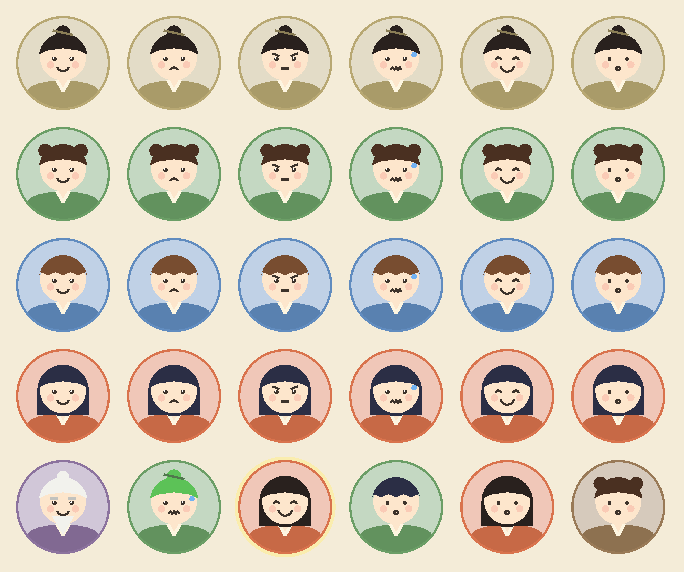

# Art style brief

This brief is for whoever draws Little Mountain Sect: a hired artist, or you. It turns the GDD's art section into a list of drawings, sizes and file names. Until the real art arrives, the game draws a placeholder of each piece in code, built from the same layers as the real art will be, so the screens can be judged now.

- **Placeholder portraits:** `game/scenes/chat/portrait.gd`.
- **Preview:** `game/tools/state_shots.gd` saves screenshots of the main screens and a portrait sheet. The sheet below came from it.
- **Still open** (MILESTONES, Gate 2): who makes the art, and the budget.



*The portrait test, drawn in code. Rows 1–4 show each hair style with the 6 faces. Row 5 shows the Elder, green hair (a failed breakthrough), glowing at night, and three generated disciples.*

## The look

- **Mood:** funny and warm. A tiny, leaky sect that you grow fond of, not an epic.
- **Shapes:** round and soft. Big heads, small bodies, simple faces with dot eyes. No sharp angles, no gore, nothing scary.
- **Lines:** soft brown ink (`#3D332A`), never pure black.
- **Colour:** soft and slightly warm, on paper-coloured backgrounds. Each spirit root has its own colour (below), used for that disciple's robe and portrait backdrop, so a player can tell who's who at a glance.
- **Text first:** the art never sits behind text. Every screen must read on a 390-pixel-wide phone.
- **Safety:**
  - Characters are young adults in modest robes.
  - Nothing is ever romantic or sexual.
  - The GDD's rule has no exceptions, because cute art can make characters look young.

## Palette

The UI colours are in `game/scenes/ui/ui_kit.gd` and the portrait colours in `portrait.gd`. Art should sit comfortably on them.

| Use | Colour | Hex |
| --- | --- | --- |
| Background (paper) | warm cream | `#F4ECD8` |
| Cards and panels | light cream | `#FDF9EF` |
| Text (ink) | dark brown | `#3D332A` |
| Soft text | brown grey | `#6B5C4C` |
| Headings, chosen buttons | jade | `#445F56` |
| Progress bars | light jade | `#6F9A8D` |
| Warnings | brick red | `#9E4533` |
| Borders | sand | `#D1C4AB` |

| Spirit root | Robe and backdrop | Hex |
| --- | --- | --- |
| Metal | brass | `#B8A873` |
| Wood | leaf green | `#6B9E66` |
| Water | river blue | `#618CBF` |
| Fire | persimmon | `#D9734C` |
| Earth | clay | `#997A57` |
| The Elder (no root) | plum | `#8C739E` |

**Hair colours:** ink `#29211F`, dark brown `#4A3021`, chestnut `#784C30` and blue-black `#2B2E45`. A failed breakthrough can turn hair bright green (`#5CC257`), and the Elder's hair is white (`#F2F2ED`).

**Skin:** the placeholder uses one tone (`#FCE6CC`) with pink cheeks (`#F5998C`). The real art should offer 4 skin tones, chosen from the disciple's id like the hair.

## Portraits

### Layers

Each portrait is put together in this order, back to front. Every layer is drawn on the same square canvas with the head in the same place, so any combination lines up.

| # | Layer | Variants | Notes |
| --- | --- | --- | --- |
| 1 | Backdrop | 1 | A circle in the root colour, lightened. Drawn in code. |
| 2 | Robe and shoulders | 1 | Drawn in greys and tinted in the game with the root colour. A crossed collar in cream. |
| 3 | Hair, back | 4 styles | Only the long style has a back layer. Drawn in greys and tinted with the hair colour. |
| 4 | Head | 4 skin tones | A round face with ears hidden by the hair. |
| 5 | Hair, front | 4 styles | Bun with a hairpin, twin buns, scalloped bangs and long. Tinted like the back hair. |
| 6 | Face | 6 expressions | Eyes, brows and mouth: happy, sad, angry, nervous (with a sweat drop), proud and thinking. Claude picks one with each reply. |
| 7 | Extras | see below | Side effects that show, and the Elder's beard. |

**The Elder** uses the same layers, with:
- a plum robe and white hair in a small bun
- a long white beard and long eyebrows
- the same 6 faces

**Side effects** show while they last:
- **Green hair:** recolours the hair.
- **Glowing at night:** a soft yellow halo behind the backdrop.
- **The other 4:** hiccups, floating, backwards qi and a squeaky voice. Each can get a small icon in a corner, such as a bubble, a cloud under the shoulders, a swirl or a music note. These are optional.

### Sizes

- **Drawing size:** 512×512 for each layer, exported as transparent PNG.
- **On screen:** 48–72 pixels in lists and cards, and about 110 pixels in a chat. Faces must read at 48 pixels: big eyes, a clear mouth and few details.

### Files

Layers go in `game/assets/portraits/`. A greyscale layer (`_grey`) is tinted in the game.

```
portraits/
  robe_grey.png
  head_<skin 1-4>.png
  hair_<style>_front_grey.png     bun, twin_buns, bangs, long
  hair_long_back_grey.png
  face_<expression>.png           happy, sad, angry, nervous, proud, thinking
  elder_hair.png, elder_beard.png, elder_robe.png
  extra_<side effect>.png         optional: hiccups, floating, backwards_qi, squeaky_voice
```

That is 1 robe, 4 heads, 5 hair layers, 6 faces, 3 Elder layers and up to 4 extras: **19 required drawings, plus 4 optional extras**. Together they make every disciple in the game.

## The mountain

One illustrated screen is the Mountain tab. The game now draws a placeholder in code (`game/scenes/game/mountain_art.gd`), and the real art should keep its layout, so the tap areas and tests stay valid.

- **Composition:** a terraced mountain with 8 building plots on 4 terraces, with sky, far peaks and drifting mist.
  - The picture is 4:3. On a phone it fills the width, with the building's card below it. On a wide screen the card sits beside it.
- **Plots:** each building stands with its base at a fixed spot, given as a fraction of the picture's width and height.

  | Building | Base (x, y) | Terrace |
  | --- | --- | --- |
  | Main Hall | 0.50, 0.30 | Top |
  | Library | 0.30, 0.51 | Second |
  | Alchemy Room | 0.70, 0.51 | Second |
  | Disciple Huts | 0.17, 0.72 | Third |
  | Training Yard | 0.50, 0.72 | Third |
  | Kitchen | 0.83, 0.72 | Third |
  | Spirit Field | 0.29, 0.93 | Bottom |
  | Mission Hall | 0.71, 0.93 | Bottom |

- **Buildings:** 8 buildings × 4 states (an empty plot with a "build here" sign, then levels 1, 2 and 3), so 32 drawings.
  - Level 1 leaks: a patched roof and drips.
  - Level 2 is mended.
  - Level 3 has gold trim, banners and lanterns.
  - The silhouettes in the placeholder:

  | Building | Silhouette |
  | --- | --- |
  | Main Hall | A hall on a stone platform with red pillars; two curved roofs from level 2 |
  | Disciple Huts | Straw huts: 1, then 2, then 3 with tiled roofs and lanterns |
  | Training Yard | A sand ring with practice dummies (1, 2, 3) and a weapon rack |
  | Spirit Field | Rows of crops on brown soil; a scarecrow at level 1, glowing herbs at 3 |
  | Kitchen | A hut with a chimney (it smokes) and a cooking pot |
  | Alchemy Room | A cauldron under a straw shelter, then a hall with a round window (it glows) |
  | Library | A one-storey reading room, then a two-storey tower with a hanging scroll |
  | Mission Hall | A notice board, then a red gate with a plaque |

- **Life:**
  - Two bands of mist drift.
  - Three birds flap across the sky every 20 seconds or so.
  - The Kitchen smokes, the Alchemy Room glows while it has brews left, and leaky roofs drip.
  - With "Less motion" on, it all stands still.
- **Sizes:**
  - The background is 1600×1200.
  - Each building is drawn in a 500×400 box with a transparent background, standing on the point 250, 370.
  - Mist strips are 2048×256, and birds are 64×64 per frame.

### Files

```
mountain/
  background.png
  mist_1.png, mist_2.png, mist_3.png
  bird_1.png … bird_4.png
  <building>_<0-3>.png     main_hall_0.png … mission_hall_3.png
```

## Everything else

- **Icons:** 64×64, in the same soft style. The placeholders are SVG in `game/scenes/ui/icons.gd`:
  - the 4 resources and Spirit Energy
  - the 3 pills
  - the 5 home tasks and the 4 missions
  - the 3 tabs
  - moods, loyalty, chat, the event scroll and the gate
- **Event cards:** no art needed. They use the two disciples' portraits.
- **Font:** Nunito, already in the game. Hand-lettered headings are optional.
- **UI:** the existing panels stay: rounded corners (8 px), a 1-pixel sand border, and buttons at least 44 px tall for thumbs.

## Asset list

| Group | Pieces | Needed by |
| --- | --- | --- |
| Portrait layers | 19 (+4 optional) | M7 |
| Mountain background, mist and birds | 1 + 3 + 4 frames | M7 |
| Buildings | 32 | M7 |
| Icons | about 30 | M7 |

## How to try art in the game

1. Put the files in `game/assets/`.
2. Change `portrait.gd` to draw the textures in the same layer order.
3. Run `state_shots.gd` (the command is at the top of the file) and compare the shots at phone and desktop sizes.
